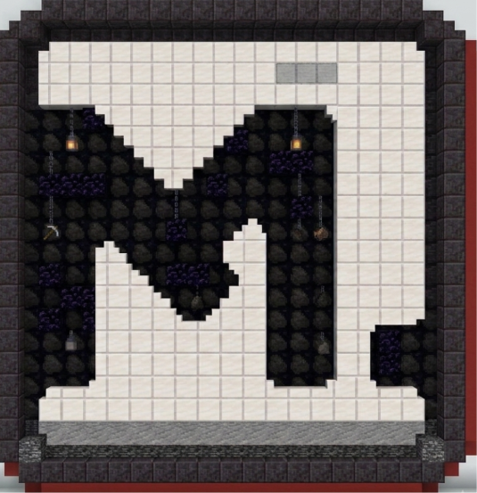

<p align="center">
  
</p>

<h1 align="center">MechKeys</h1>

<p align="center">
  Mechanical keyboard and mouse click sounds for Minecraft, using <a href="https://github.com/hainguyents13/mechvibes">Mechvibes</a>-format sound packs.<br>
  Developed by <b>NotThatLonely</b> &nbsp;·&nbsp; Version <b>1.0.0</b> &nbsp;·&nbsp; MIT license
</p>

> **Unofficial & independent.** MechKeys is not affiliated with or endorsed by Mechvibes. It reads the Mechvibes sound-pack *format*, so you can use packs you download or make yourself. See [NOTICE.md](NOTICE.md) and the [credits](#credits).

One repository, one shared sound engine, one build workflow for every supported Minecraft version.

## Supported versions

| Minecraft | Loader | Folder | Jar name | Java |
|---|---|---|---|---|
| 26.1 | Fabric (Loader 0.19.5+, Fabric API) | [`fabric/`](fabric) | `MechKeys-26.1-1.0.0.jar` | 25 |
| 26.2 | Fabric | [`fabric/`](fabric) | `MechKeys-26.2-1.0.0.jar` | 25 |
| 26.3 | Fabric | [`fabric/`](fabric) | `MechKeys-26.3-1.0.0.jar` | 25 |
| 1.8.9 | Forge 11.15.1.2318 (or a later 1.8.9 build) | [`forge-1.8.9/`](forge-1.8.9) | `MechKeys-1.8.9-1.0.0.jar` | 8 |

Client-side only. Features and screens are the same on every version.

## What it does

* Plays a sound for every key press and every mouse click (press **and** release when the pack has both). Client-side only; it never cancels or changes input and only reacts while the game window is focused.
* **Keyboard and mouse are separate**, like Mechvibes: each has its own profile, ON/OFF switch and volume.
* Ships with two default packs: **amazin keychron q3 bluex** (keyboard) and **X2 SuperStrike** (mouse). See [Default sound packs](#default-sound-packs).
* Imports Mechvibes V2 (`single` / `multi`) and legacy V1 packs from a `.zip`, a folder, or a direct link.

## Install

1. Install the loader for your version (table above). Fabric also needs **Fabric API**.
2. Download the jar for your Minecraft version from the [Releases](../../releases) page (or from the **Actions** build artifacts) and put it in your `mods` folder.
3. Start the game. On the first run the two default packs are installed to `.minecraft/config/mechkeys/profiles/` and selected automatically.
4. Open the MechKeys screen with **K** (rebind in *Controls > MechKeys*) or type `/mechkeys`.

## The screen

```
KEYBOARD  - [<] profile [>]   Keyboard: ON/OFF   Volume
MOUSE     - [<] profile [>]   Mouse: ON/OFF      Volume
[Profiles / Import]  [Done]
```

That is all the settings there are.

## Default sound packs

MechKeys installs these on first run (they are inside the jar):

| Pack | Type | Author |
|---|---|---|
| **amazin keychron q3 bluex** | Keyboard | bluecxmbo |
| **X2 SuperStrike MOUSE** | Mouse | m0uh |

Both come from the Mechvibes community library and carry a *personal use only* license (see [NOTICE.md](NOTICE.md)). If you delete them they are not re-installed.

The [`soundpacks/`](soundpacks) folder of this repository also contains **11 extra ready-to-import packs** (7 keyboard, 4 mouse), e.g. CherryMX Blue / Red / Brown / Black, EG Oreo and a few mouse packs. They are optional: add them exactly like any other pack, see below. Full list: [docs/SOUNDPACKS.md](docs/SOUNDPACKS.md).

## How to add sound packs

A sound pack is a `.zip` containing a `config.json` and its audio. Any Mechvibes pack works.

1. **Get a pack.** Download one from the Mechvibes library / community, take one from [`soundpacks/`](soundpacks), or [make your own](#make-your-own-pack-mechvibes-editor).
2. **Keep it as a `.zip`.** You do not need to unzip it.
3. Start Minecraft and press **K** (or run `/mechkeys`).
4. Click **Profiles / Import**, then **Import...**
5. Give MechKeys the pack in any of these ways:
   * paste the **path** to the `.zip` (or to an unpacked folder). Quotes from Windows "Copy as path" are fine;
   * paste a **direct link** to the `.zip` (`https://...`);
   * click **Browse...** and pick the `.zip` in the normal file dialog.
6. Confirm. MechKeys checks the pack and installs it. A keyboard pack goes to the keyboard, a mouse pack (all keys are `Mouse...`) goes to the mouse, automatically.
7. Back on the main screen, use the **[<] [>]** arrows to select the profile, make sure that device is **ON**, and type or click to test.

**Manual alternative:** unzip the pack so that `config.json` and the audio are inside one folder, put that folder in `.minecraft/config/mechkeys/profiles/<any-name>/`, and reopen the Profiles screen.

**Audio formats:** `.wav` and `.ogg` play directly. If a pack uses `.mp3`, MechKeys converts it **once** with `ffmpeg` if ffmpeg is installed (on your PATH); otherwise the import stops with a message asking you to convert the audio to `.wav` / `.ogg`. FLAC is not supported.
**Limits:** 64 MB per audio file, 256 MB per archive.

More detail and troubleshooting for packs: [docs/SOUNDPACKS.md](docs/SOUNDPACKS.md).

## Make your own pack (Mechvibes editor)

The Mechvibes editor runs in the browser and builds a keyboard or mouse pack from a recording (or from a typing video), then exports a `.zip` that MechKeys can import. A copy of its documentation is in [docs/MECHVIBES_EDITOR.md](docs/MECHVIBES_EDITOR.md). In short: choose Keyboard or Mouse, drop in audio, select the keys, mark each sound on the waveform, **Apply**, **Preview**, **Export**, then import the exported zip as described above. Prefer OGG or WAV audio.

## Folder layout

```
.minecraft/config/mechkeys/
  settings.json         the 6 settings above
  profiles/<id>/        config.json + audio (never modified)
```

## Troubleshooting

| Symptom | Fix |
|---|---|
| No sound | Is that device's switch ON and a profile shown? A red audio error means Java has no audio output device. |
| "Skipped invalid: ..." in Profiles | That folder's `config.json` is broken; details in `logs/latest.log` (search `MechKeys`). |
| Import says MP3 can't be decoded | Convert the pack's audio to `.wav`/`.ogg`, or install ffmpeg and import again. |
| Import says the pack is not a pack | The zip needs a `config.json` and at least one audio file. |
| Browse... does nothing | The OS file dialog isn't available; paste the path instead. |
| Sounds doubled | Disable Minecraft's own click sounds in a resource pack. |

## Repository layout

```
MechKeys/
  common/          shared, Minecraft-free core: pack loader, importer, mixer, engine, default packs, tests
  fabric/          Fabric 26.x module  (one source tree, versions/<mc>.properties per Minecraft version)
  forge-1.8.9/     Forge 1.8.9 module
  soundpacks/      optional ready-to-import packs (Keyboard/, Mouse/)
  docs/            sound packs, Mechvibes editor docs, porting guide, compatibility, testing
  assets/          logo
  .github/workflows/build.yml   one workflow, builds every version
  version.properties            the single release version
```

## Build

CI builds everything (`.github/workflows/build.yml`): Fabric 26.1 / 26.2 / 26.3 and Forge 1.8.9 as separate jobs; a tag `v*` publishes all jars to one GitHub release.

Locally:

```
# Fabric (JDK 25, Gradle 9.4)
cd fabric && gradle build -Pmc=26.1        # or 26.2 / 26.3  -> fabric/build/libs/

# Forge 1.8.9 (JDK 8, Gradle 2.14.1, ForgeGradle 2.1)
cd forge-1.8.9 && gradle build             # -> forge-1.8.9/build/libs/
```

Adding a new Minecraft version later? Read [docs/PORTING.md](docs/PORTING.md); the notes are also inside the source files that usually need changes.

## Credits

* **[Mechvibes](https://github.com/hainguyents13/mechvibes)** by Hải Nguyễn (MIT): the sound-pack format MechKeys reads, the V1 key-code table, and the Mechvibes editor and library that packs come from. MechKeys is inspired by Mechvibes. Thank you!
* **Sound pack authors**: bluecxmbo, m0uh, and the authors of the packs in `soundpacks/` (see [docs/SOUNDPACKS.md](docs/SOUNDPACKS.md)).
* **NotThatLonely**: MechKeys developer.

## License

MIT (see [LICENSE](LICENSE)). Third-party notices and the bundled packs' terms are in [NOTICE.md](NOTICE.md).
